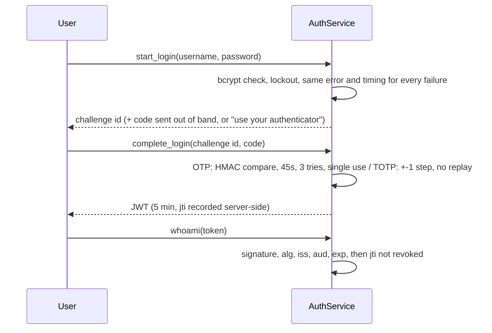

# layered-auth

Password login, a second factor, and session tokens that can actually be revoked. Each layer is built to cover a weakness in the one before it, and there's an attack script that tries to break all of them.

```
python -m layered_auth attacks
```

```
BLOCKED  Online password guessing           6 wrong guesses -> account locked; correct password refused while locked
BLOCKED  Username enumeration (messages)    unknown user, wrong password and 100-byte password all give the same message
BLOCKED  Username enumeration (timing)      first version: real user 291 ms vs unknown 0.01 ms. now: 284 ms vs 274 ms
BLOCKED  Offline crack of leaked OTP table  leaked OTP table: SHA-256 version cracked in 0.9s; HMAC version not recoverable without the server key
BLOCKED  OTP guessing                       3 wrong codes -> code and login session invalidated
BLOCKED  OTP replay                         a used code (and its challenge) can't be submitted again
BLOCKED  Skip the password step             second factor without a password-verified challenge is refused
BLOCKED  TOTP replay                        a shoulder-surfed TOTP code can't be reused in the same 30s window
BLOCKED  JWT alg=none                       token with alg=none and no signature
BLOCKED  JWT signed with guessed key        valid-looking token signed with a guessed key
BLOCKED  JWT payload tampering              sub changed to admin, original signature kept
BLOCKED  JWT for another audience           correctly signed token meant for a different service
BLOCKED  Revoked token reuse                token used after logout (signature and exp still valid)
BLOCKED  Stolen sessions after reset        3 sessions, 'log out everywhere' -> all rejected
BLOCKED  Expired token                      token whose exp passed an hour ago

15/15 attacks blocked
```

## Version 2: what I found when I attacked my own code

The first version had bcrypt, account lockout, an OTP second factor and JWTs with a revocation list. On paper it covered the usual threats. When I wrote attacks against it, three of those protections turned out to be weaker than I thought.

**1. Hashing the OTP didn't protect it.** I stored `SHA-256(code)` so that a leaked OTP file wouldn't give away live codes. A 6-digit code only has a million possible values, and Python hashes all of them in under a second. The hash bought nothing. The OTP table now stores `HMAC-SHA256(server_key, username:code)`. The key isn't in the database, so a leaked table can't be brute-forced.

**2. The generic error message still leaked usernames.** "Invalid username or password" came back for both cases, but an unknown username returned in 0.01 ms, while a real username took about 290 ms because bcrypt actually ran. Anyone timing the responses could build a list of valid accounts. Unknown usernames now run bcrypt against a dummy hash, so both paths take the same time. A locked account gets the same message and the same timing too.

**3. The JWT secret was a string in the source code.** Anyone with the repo could sign their own tokens. The secret now comes from `AUTH_JWT_SECRET`, and the service refuses to start if it's missing or shorter than 32 bytes.

Other changes in version 2:

- **TOTP (authenticator apps)**, written from RFC 6238 with only the standard library and checked against the RFC's test vectors. Each 30-second code works once.
- **The two login steps are linked.** A correct password creates a short-lived challenge, and the second factor is only accepted against that challenge. Before, the OTP check didn't know whether the password step had happened at all.
- **"Log out everywhere"**, which revokes every token for a user, for example after a password reset.
- **SQLite instead of JSON/text files.** The failed-attempt counter is updated atomically, so parallel guesses can't share one count and get extra tries.
- **Stricter JWT validation**: algorithm pinned to HS256, and `iss`, `aud`, `nbf` and `jti` all required.
- **Password policy**: minimum 12 characters, maximum 72 bytes (bcrypt's limit), and common passwords or passwords containing the username are rejected.
- **No secrets in the audit log.** Tokens are logged by `jti` only, and there's a test that checks this.

## How a login works



## Run it

```bash
pip install -e ".[dev]"

python -m layered_auth attacks     # the table above
python -m layered_auth demo        # one full login with audit log output
pytest                             # 51 tests

# interactive, with real secrets
export AUTH_JWT_SECRET="$(python -c 'import secrets; print(secrets.token_urlsafe(48))')"
export AUTH_OTP_KEY="$(python -c 'import secrets; print(secrets.token_urlsafe(48))')"
python -m layered_auth cli
```

In the CLI, option 4 prints an `otpauth://` URI. Paste it into an authenticator app, or turn it into a QR code, and every later login asks for the app code instead of an emailed one.

## Layout

```
layered_auth/
  passwords.py   bcrypt, policy, lockout, constant-time failure path
  otp.py         emailed one-time codes, HMAC at rest
  totp.py        RFC 6238 / RFC 4226, replay protection
  tokens.py      JWT issue / validate / revoke / revoke_all
  service.py     the two-step login flow that ties it together
  store.py       SQLite schema
  attacks.py     the attack script
tests/           51 tests, including the RFC test vectors
docs/threat-model.md
```

## What this doesn't do

The lockout is per account. That stops guessing, but it also lets anyone lock a victim out on purpose. A real deployment would add per-IP rate limiting, and ideally a CAPTCHA or progressive delay instead of a hard lock.

The TOTP secret sits in the database unencrypted. It should be encrypted with a key held outside the database, the same way the OTP HMAC key is.

There's no transport layer here. Tokens belong in `HttpOnly; Secure; SameSite` cookies or behind TLS, and that's the job of whatever web framework sits on top.

More detail in [docs/threat-model.md](docs/threat-model.md).

## License

MIT
